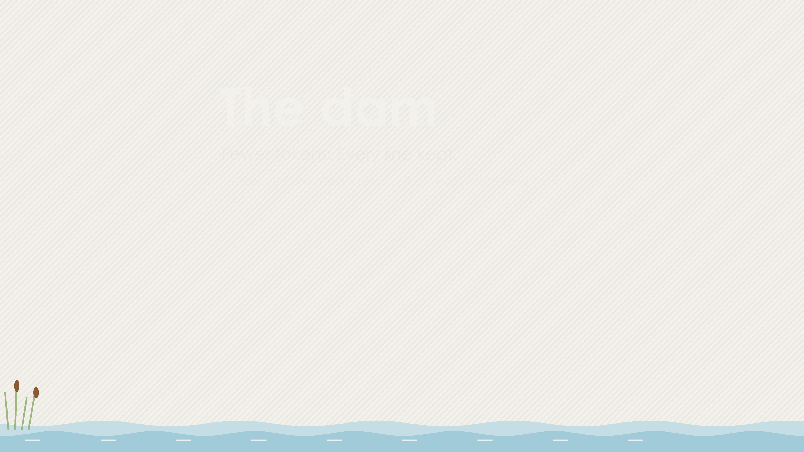
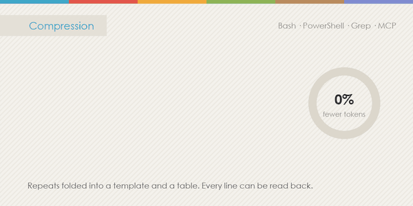
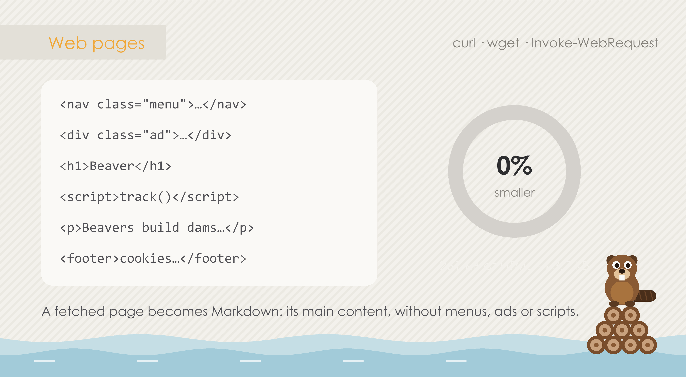
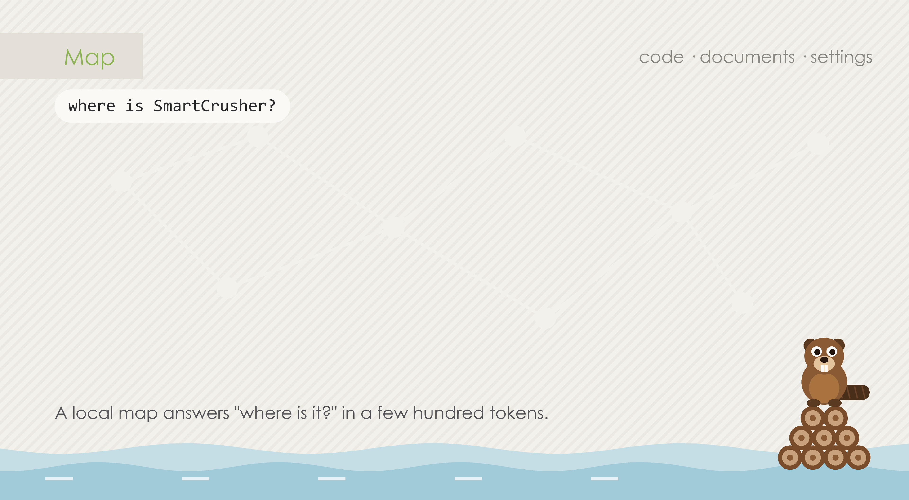
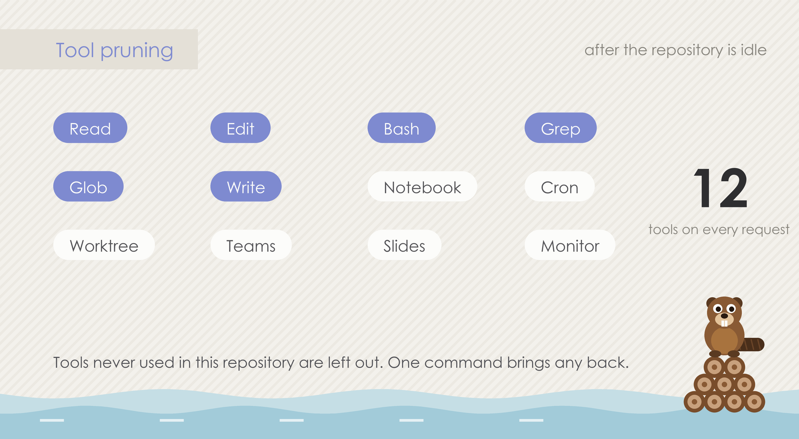
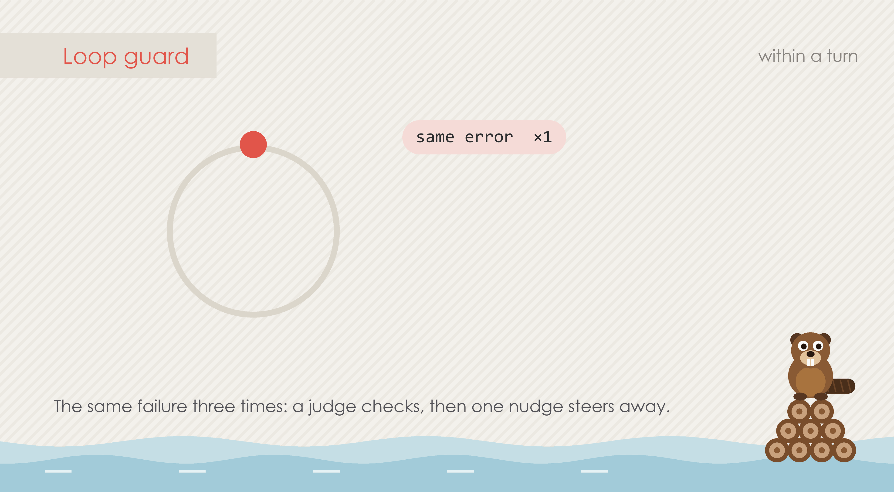
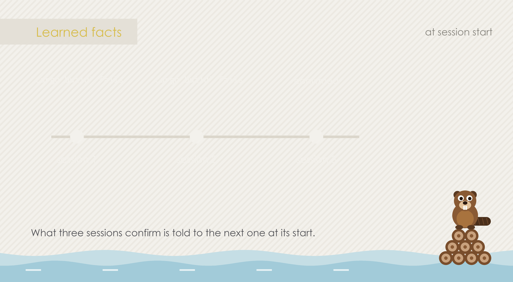
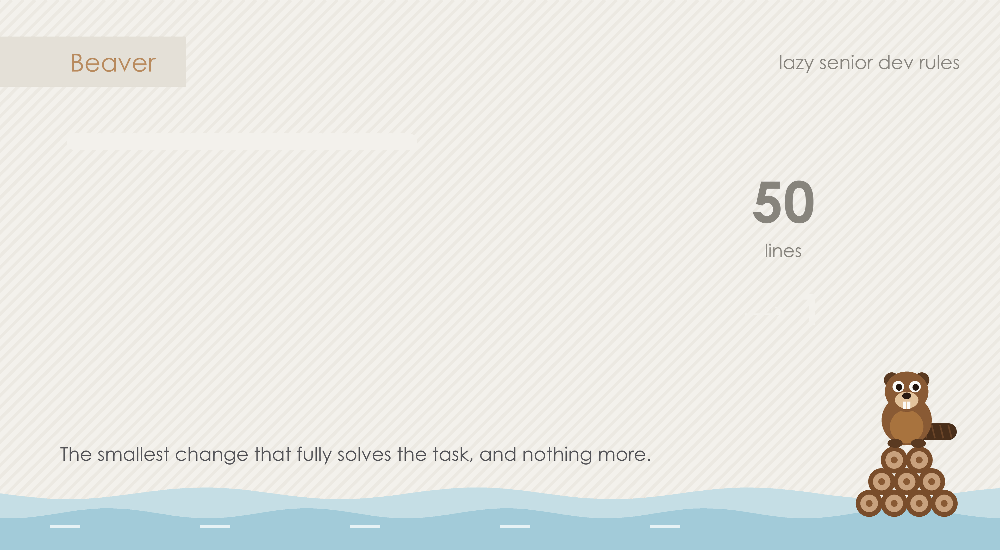
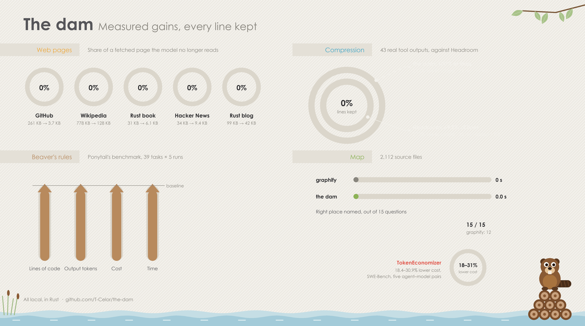

<p align="center">
  
</p>

<h1 align="center">The dam</h1>

<p align="center">
  <strong>Spend fewer tokens in Claude Code without losing a line.</strong>
</p>

<p align="center">
  <a href="https://github.com/T-Celor/the-dam/actions/workflows/ci.yml"></a>
  <a href="LICENSE"></a>
  
  
</p>

<p align="center">
  <picture>
    <source media="(prefers-color-scheme: dark) and (prefers-reduced-motion: reduce)" srcset="assets/intro-dark.png">
    <source media="(prefers-reduced-motion: reduce)" srcset="assets/intro.png">
    <source media="(prefers-color-scheme: dark)" srcset="assets/intro-dark.gif">
    
  </picture>
</p>

## Contents

[Install](#install) · [Commands](#commands) · [Status line](#status-line) · [How it works](#how-it-works) · [Gains](#gains) · [Built on](#built-on) · [Maintenance](#maintenance) · [Limits](#limits) · [Licence](#licence)

## Install

```
/plugin marketplace add T-Celor/the-dam
/plugin install the-dam@the-dam
```

Restart Claude Code. The programs come prebuilt for Windows x64, Linux x64 and arm64, and macOS x64 and arm64. On any other system the plugin offers to build them with `cargo`.

If the separate TokenEconomizer or Ponytail plugins are installed, turn them off so nothing runs twice:

```
claude plugin disable tokeneconomizer@tokeneconomizer
claude plugin disable ponytail@ponytail
```

### Codex and GitHub Copilot CLI

```bash
codex plugin marketplace add T-Celor/the-dam
codex plugin add the-dam@the-dam
```

```bash
copilot plugin marketplace add T-Celor/the-dam
copilot plugin install the-dam@the-dam
```

In Codex, trust the plugin's hooks with `/hooks` before they run.

| | Claude Code | Codex | Copilot |
|---|---|---|---|
| Compression and web pages | ✅ | ✅ | ✅ |
| Map, at start and after a search | ✅ | ✅ | ✅ |
| Map answers for code a prompt names | ✅ | ✅ | ✅ |
| Loop guard, learned facts | ✅ | ✅ | ✅ |
| Beaver, skills, `doctor`, `fallback` | ✅ | ✅ | ✅ |
| Tool pruning | ✅ deny list | ✅ capabilities in `.codex/config.toml` | ✅ MCP servers in `.github/copilot/settings.local.json` |
| 💧 counter: status line | ✅ | ❌ built-in items only | ✅ `/the-dam:statusline install` |
| 💧 counter: on demand | `/the-dam` pane | `/the-dam:journal` | `/the-dam:journal` |

Codex cannot rewrite a tool's output, so the condensed one comes back as the hook's feedback, which Codex gives the model in its place. Copilot drops what its prompt hook prints, so the map's answer for a prompt goes into the prompt the model receives (`userPromptTransformed`). The loop guard's judge runs through the host's own CLI (`claude -p`, `codex exec` in a read-only sandbox, `copilot -p` with every tool denied).

## Commands

| Command | What it does |
|---|---|
| `/the-dam` | The session's journal beside the chat, newest first, with its totals |
| `/the-dam-compress` | Compression on or off |
| `/the-dam:journal` | What the dam saved this session and since it was installed, in any host |
| `/the-dam:models` | Claude Code and Codex. Claude Code: the first session after installing sets Sonnet 5.5 as the session model and Opus 5.5 as advisor in your own settings (`/the-dam:models uninstall` puts back what was there, and it stays undone); the built-in subagents run on Haiku 5.5 through the plugin itself. Codex: the first session sets `gpt-6.1-sol` for the session and `gpt-6-luna` for subagents in `~/.codex/config.toml` and adds an `advisor` agent (`gpt-6-astra`) and a `worker` agent (`gpt-6-luna`) |
| `/the-dam:statusline install` | The 💧 counter in Copilot's status line (`uninstall` takes it out) |
| `/the-dam:status` | What TokenEconomizer learned for this repository |
| `/the-dam:toolprune` | The tools left out here; give one back or apply a waiting list |
| `/the-dam:config` | Each TokenEconomizer mechanism on, off or tuned |
| `/the-dam:microskills` | The learned facts given at session start |
| `/the-dam:repos` | Every repository with learned state |
| `/the-dam:doctor` | Whether the dam's context reaches the model here, and what blocks it |
| `/the-dam:fallback on\|off` | Where hooks are blocked, the model fetches that context itself |
| `/beaver lite\|full\|ultra\|off` | Beaver's level for this session (`full` by default) |
| `/the-dam:beaver-review`, `:beaver-audit` | Review of a change, or of the whole repository |
| `/the-dam:beaver-debt` | Every `shortcut:` comment, as a ledger |
| `/the-dam:design`, `:goldfish`, `:goldfish-loop`, `:resolve`, `:bootstrap`, `:drift` | Idea to specification; review (once or looped) and settling of a design by reviewers with none of the conversation (the map gives them the code it names); documents checked against the map |
| `/the-dam:beaver-gain`, `:beaver-help` | Beaver's benchmark and reference card |

## Status line

```
🦫 full · 💧 412k/12.4M (3.2%) · 🪵 27 · 🌀 1 · 🧠 5 · 🗺️ 2.2k · 🌊 31%
```

| Icon | Figure |
|---|---|
| 🦫 | Beaver's level |
| 💧 | Tokens the session's requests did not carry, out of all they counted. A token taken out of a tool output counts once for each later request, since each would have re-read it, until a compaction. A pruned MCP tool's schema counts once per request. |
| 🪵 | Tools left out, `+n` waiting |
| 🌀 | Loops stopped |
| 🧠 | Facts given to the model |
| 🗺️ | Places on the project's map |
| 🌊 | Context window in use |

A `0`, `off` or `–` means the tool has had nothing to do yet.

## How it works

### Compression

<picture><source media="(prefers-color-scheme: dark)" srcset="assets/part-compression-dark.gif"></picture>

`dam squeeze` takes Bash, PowerShell, Grep and MCP outputs of 2,000 characters or more. Lines that differ only by numbers become a template and a table of values, repeated lines a count, search hits a list per file, JSON records a table. Errors and outliers stay as they are, and each result is decoded and checked against the source before the model sees it. The original stays in `~/.claude/the-dam-outputs/`.

### Web pages

<picture><source media="(prefers-color-scheme: dark)" srcset="assets/part-web-dark.gif"></picture>

When a command fetches a page (`curl`, `wget`, `Invoke-WebRequest`), `dam squeeze --web` keeps its main content, as Readability picks it, and writes it as Markdown with html-to-markdown's rules for escaping, tables, code and links. The full HTML is kept in a file.

### Map

<picture><source media="(prefers-color-scheme: dark)" srcset="assets/part-map-dark.gif"></picture>

`dam graph` records who defines, calls, extends and imports what in 10 languages, plus document headings and links and the keys of YAML, TOML and JSON. It is rebuilt at each session start. When a prompt or a `Grep` names something, where it is defined and what calls it are added for the model.

### Tool pruning

<picture><source media="(prefers-color-scheme: dark)" srcset="assets/part-pruning-dark.gif"></picture>

A tool unused over 10 prompts in 2 sessions, or over 5 sessions, is left out of later sessions once the repository has been idle for an hour. Every request is then shorter. `/the-dam:toolprune` gives any tool back.

### Loop guard

<picture><source media="(prefers-color-scheme: dark)" srcset="assets/part-loops-dark.gif"></picture>

When a turn keeps hitting the same failure, a judge model checks it and the model gets one note to try another approach.

### Learned facts

<picture><source media="(prefers-color-scheme: dark)" srcset="assets/part-facts-dark.gif"></picture>

Failures repeated across sessions, and a model review every 3 sessions, become facts once 3 sessions confirm them: a build step, or the command spelling that works here. Each new session starts with them.

### Beaver

<picture><source media="(prefers-color-scheme: dark)" srcset="assets/part-beaver-dark.gif"></picture>

Ponytail's rules, rewritten: make the smallest change that fully solves the task, and ask the map before searching. They are given at session start and to each subagent.

Several sessions can run at once. Each keeps its own level, originals and counts.

## Gains

<picture><source media="(prefers-color-scheme: dark) and (prefers-reduced-motion: reduce)" srcset="assets/gains-dark.png"><source media="(prefers-reduced-motion: reduce)" srcset="assets/gains.png"><source media="(prefers-color-scheme: dark)" srcset="assets/gains-dark.gif"></picture>

**Compression**, against [Headroom](https://github.com/headroomlabs-ai/headroom) 0.42 in token mode on 43 real outputs of 6,000 characters or more:

| | Headroom | the dam |
|---|---|---|
| Tokens saved | **27.3%** | 24.1% |
| Lines recoverable | 69.9% | **100%** |
| Median time per output | 45 ms warm, about 8 s cold | **15 ms** |
| Memory | about 1 GB | **11 MB** |

Headroom saves a little more because it drops what goes past its caps.

That corpus is outputs chosen for their repeated lines. On every tool result of a long working session (8,400 results, 3.0M tokens, from Claude Code transcripts) the lossless folding saves about **2%**: most results are file reads, diffs and test output with few repeated lines. Long output of build, test and install commands (from about 1,000 tokens) is also shortened: its first and last lines and every error or warning line stay, the middle is left out with its path (`DAM_ELIDE=off` keeps every line). Output of `cat`, `sed`, `grep`, `git diff` and the like is never shortened. In those sessions this brings the total to **2.6%**: most large output is code and search results read on purpose. Measure your own sessions with `dam squeeze bench ~/.claude/projects/*/*.jsonl`.

**Web pages**, the HTML as fetched against the Markdown the model reads:

| Page | HTML | Markdown | Saved | Time |
|---|---|---|---|---|
| GitHub repository page | 261 KB | 3.7 KB | **99%** | 0.11 s |
| Wikipedia, "Beaver" | 778 KB | 128 KB | **84%** | 0.18 s |
| The Rust book, installation | 31 KB | 6.1 KB | **81%** | 0.15 s |
| Hacker News front page | 34 KB | 9.4 KB | **73%** | 0.13 s |
| The Rust blog | 99 KB | 42 KB | **58%** | 0.14 s |

On html-to-markdown's own test files, the conversion matches 75% of lines, setting aside HTML comments (left out on purpose) and column padding.

**Map**, against [graphify](https://graphify.com)'s structural graph on four repositories of 18 to 2,112 source files:

| | graphify | the dam |
|---|---|---|
| Build time, 2,112 files | 816 s | **1.5 s** |
| Definitions / calls / imports found | reference | 96–99.9% / 96–100% / 80–100% |
| Right place named, 15 questions | 12 | **15** |
| Mean answer size | 1,656 tokens | **772 tokens** |

**Published by the projects it builds on:** TokenEconomizer lowers mean cost by 18.4 to 30.9% on SWE-Bench tasks across five agent and model pairs ([paper](https://arxiv.org/abs/2610.22732)). Ponytail's rules give 53% fewer lines of code, 45% fewer output tokens, 26% lower cost and 41% less time on 39 tasks run 5 times each.

**The Rust rewrite of TokenEconomizer**, against Microsoft's Python on the same inputs:

| Compared | Cases | Differences |
|---|---|---|
| Hooks through a turn, real and made-up sessions | 7,664 events | 0 |
| Whole sessions with tool pruning and facts | 240 hooks | 0 |
| Test-run detection | 25 commands | 0 |
| Session start, fold, pricing, settings, judge | 820 | 1 (a checkout count in `repos --json`) |

## Built on

| Project | Licence | Used for | Followed at |
|---|---|---|---|
| [TokenEconomizer](https://github.com/microsoft/TokenEconomizer) (Microsoft) | Apache 2.0 | Loop guard, tool pruning, learned facts, rewritten in Rust | `d58755d` |
| [Ponytail](https://github.com/DietrichGebert/ponytail) (Dietrich Gebert) | MIT | Beaver's rules and hooks | `v5.3.3` |
| [Headroom](https://github.com/headroomlabs-ai/headroom) | Apache 2.0 | The folding rules of its lossless compaction | `fc1ba89` |
| [markdowner](https://github.com/supermemoryai/markdowner) | MIT | Web pages for a model as Markdown | `f887834` |
| [html-to-markdown](https://github.com/JohannesKaufmann/html-to-markdown) | MIT | Escaping, table and layout rules, and its tests | `v2.5.2` |
| [Readability](https://github.com/mozilla/readability), [Turndown](https://github.com/mixmark-io/turndown) | Apache 2.0, MIT | Main-content choice and Markdown rules | – |
| [graphify](https://graphify.com) | – | The map's reference measurements; no code taken | `v0.9.99` |
| [Elephant-Goldfish Model](https://github.com/google/elephant-goldfish-model) | Apache 2.0 | The method of `design`, `goldfish` and `drift`; reviewers shortened, on the model ladder, using the map | `e9e1f06` |

[NOTICE](NOTICE) credits each with its licence. None of their authors endorse this project.

## Maintenance

| What | How |
|---|---|
| Upstream | [`UPSTREAM`](UPSTREAM) records the version followed for each project. `dam upstream` lists what moved since (commits, and files under the ported paths with `gh`); you port by hand, then `dam upstream pin NAME`. A weekly workflow opens an issue when one moved. |
| Tests | `cd dam && cargo test` (unit tests, the programs end to end, the Codex and Copilot packaging), `claude plugin test .`, `claude plugin validate .` |
| Hosts | `.claude-plugin/plugin.json` and `hooks/hooks.json` are the one declaration. `dam hosts` writes the Codex and Copilot manifests, marketplaces and hook files from them, and the tests fail when those are out of date. |
| Benchmarks | `benchmarks/` holds the scripts behind the figures above |
| CI | On every push: tests on Windows, Linux and macOS, including each program run end to end without a model (`dam/tests/smoke.rs`). CI then builds the programs for five platforms and commits them. |
| Pictures | `assets/` holds the finished pictures; the script that drew them (Python) was removed in 0.21, and stays in the Git history |
| Changes | [CHANGELOG.md](CHANGELOG.md) |

```
hooks/register.tsx    Claude Code's side: status line, /the-dam pane, accounting; each decision comes from dam
dam/src/bin/dam.rs    the one program: dam squeeze, dam graph, dam beaver, dam te
dam/src/              the library they share
skills/               every command, for Claude Code, Codex and Copilot alike
scripts/              dam-run (finds dam for this system), te
```

## Managed setups

Some company setups block plugin hooks or modules (`disableAllHooks`, `allowManagedHooksOnly`). The dam keeps working there, but nothing it adds reaches the model: no map, no learned facts, no Beaver rules. `/the-dam:doctor` shows which parts ran and names the policy when it can read it.

`/the-dam:fallback on` adds one marked instruction to your user instructions file, never to the project: `~/.claude/CLAUDE.md`, or with Codex `~/.codex/AGENTS.md`, or with Copilot `~/.copilot/copilot-instructions.md` (the `fallback` and `doctor` skills work in all three). In each project the model runs `te context` once, which prints what the hooks would have added. It also learns to pipe long outputs through `dam squeeze`. Nothing changes where hooks work, and `/the-dam:fallback off` removes the instruction. Tool pruning, the loop guard and automatic compression still need hooks or the module.

## Limits

- Token figures are estimates at four characters per token.
- Real Claude Code sessions have only been run on Windows. CI covers the other systems without a model.
- The Windows programs are not signed, so Windows may warn about them.
- The map is a scanner, not a parser, so unusual syntax can be missed. Documents are read for headings, links and quoted names only.
- Web conversion drops `data:` images, HTML comments, and empty or in-page links.
- The Codex and Copilot packaging is tested against each host's documented hook payloads (`node --test scripts/hosts.test.mjs`), not in real Codex or Copilot sessions. How Codex shows a hook's feedback in place of an output is not verified.

## Licence

[PolyForm Strict 1.0.0](LICENSE): free for personal and other noncommercial use, with no right to redistribute, modify or use it commercially. It is source-available, not open source. For a commercial licence, contact the author through GitHub. Versions up to 0.15.0 were published under Apache 2.0 and stay under it. The projects it builds on keep their own licences, listed in [NOTICE](NOTICE). The dam is not affiliated with Microsoft, Anthropic or those projects' authors.
