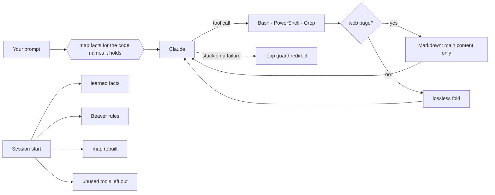
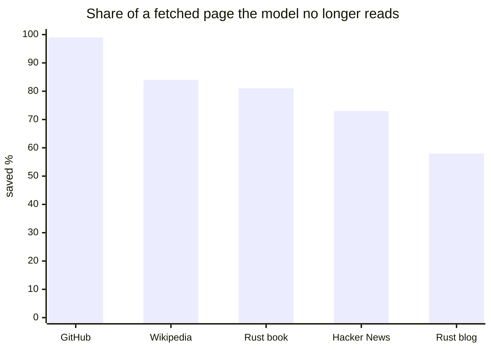
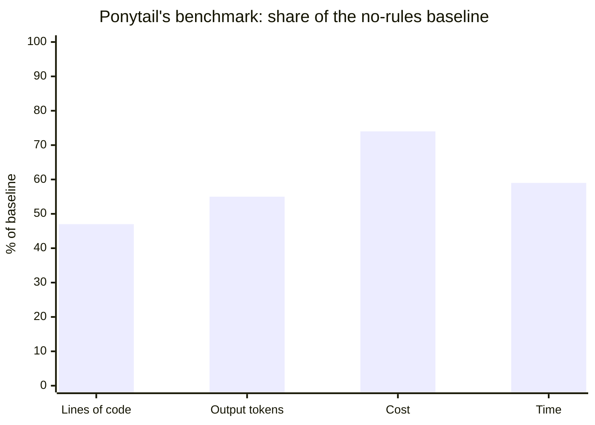

<p align="center">
  
</p>

<h1 align="center">The dam</h1>

<p align="center">
  <strong>Spend fewer tokens in Claude Code, without losing a line.</strong><br>
  Lossless output compression, web pages as Markdown, a local map of the project, a loop guard, tool pruning and lazy-senior-dev rules, in one plugin.
</p>

<p align="center">
  <a href="https://github.com/T-Celor/the-dam/actions/workflows/ci.yml"></a>
  <a href="LICENSE"></a>
  
  
</p>

<p align="center">
  <picture>
    <source media="(prefers-reduced-motion: reduce)" srcset="assets/teaser.png">
    
  </picture>
</p>

```
🦫 full · 💧 3.1k 25% · 🪵 27 · 🌀 1 · 🧠 5 · 🗺️ 2.2k · 🌊 31%
```

## Contents

[Install](#install) · [Commands](#commands) · [The status line](#the-status-line) · [How it works](#how-it-works) · [Gains](#gains) · [Built on](#built-on-and-followed) · [Maintenance](#maintenance) · [Limits](#limits) · [Licence](#licence)

## Install

In Claude Code:

```
/plugin marketplace add T-Celor/the-dam
/plugin install the-dam@the-dam
```

Restart Claude Code. Every part starts by itself at each session.

| You need | For |
|---|---|
| Nothing | Windows x64, Linux x64 and arm64, macOS x64 and arm64: the programs come prebuilt |
| `cargo` | Any other system: the plugin offers to build them |

If you also run the separate TokenEconomizer or Ponytail plugins, turn them off so they do not act twice:

```
claude plugin disable tokeneconomizer@tokeneconomizer
claude plugin disable ponytail@ponytail
```

## Commands

| Command | What it does |
|---|---|
| `/the-dam` | Opens the session's journal beside the chat: what each tool did, newest first, then the totals |
| `/the-dam-compress` | Turns compression on or off |
| `/the-dam:status` | What TokenEconomizer learned for this repository, with a plain explanation of each mechanism's state |
| `/the-dam:toolprune` | The tools left out of this repository's sessions; give one back, or apply a waiting list now |
| `/the-dam:config` | Turn each TokenEconomizer mechanism on or off, or tune it |
| `/the-dam:microskills` | The repository facts learned and given to the model at session start |
| `/the-dam:repos` | Every repository with learned state |
| `/beaver lite\|full\|ultra\|off` | Beaver's level for this session (`full` by default) |
| `/the-dam:beaver-review` | Review of a change: bugs, security, load, missing tests, what to cut |
| `/the-dam:beaver-audit` | The same review for the whole repository, ranked |
| `/the-dam:beaver-debt` | Every `shortcut:` comment, as a ledger |
| `/the-dam:beaver-gain`, `:beaver-help` | Beaver's benchmark and reference card |

## The status line

One icon per tool, always in the same order. `0`, `off` or `–` (nothing to measure yet) when a tool has done nothing.

| Icon | Tool | Figure |
|---|---|---|
| 🦫 | Beaver | its level in this session |
| 💧 | Compression | tokens saved in this session, and their share of everything the tools printed |
| 🪵 | Tool pruning | tools left out, `+n` waiting to be |
| 🌀 | Loop guard | loops stopped |
| 🧠 | Learned facts | facts given to the model |
| 🗺️ | Map | places on the project's map |
| 🌊 | Context | share of the context window in use |

`/the-dam` adds the same for the project and for every project.

## How it works



| Part | Concept | What the model gets |
|---|---|---|
| **Compression** `dam-squeeze` | Lines that differ only by numbers become a template and a table of values; identical lines a count; search hits and paths grouped by file; JSON records a table. Errors and outliers stay plain lines. Every result is decoded and checked against the source before use. | The same information in fewer tokens, the original in `~/.claude/the-dam-outputs/` |
| **Web pages** `dam-squeeze --web` | A page a command fetched (`curl`, `wget`, `Invoke-WebRequest`): its main content picked as Readability does, written as Markdown with html-to-markdown's rules (escaping, tables with spans, code blocks, absolute links). | Title, address and the page as Markdown; the full HTML kept in a file |
| **Map** `dam-graph` | Who defines, calls, extends and imports what, in 10 languages, plus document headings, links and quoted code names, and the keys of YAML, TOML and JSON. Rebuilt in the background at session start. | Where a name is defined, what calls it and which document describes it, added when a prompt or a `Grep` names it |
| **Loop guard** | A turn repeating the same failure is checked by a judge model, then redirected once. | A short note to try another approach |
| **Tool pruning** | A tool unused over 10 prompts in 2 sessions, or 5 sessions, is left out of later sessions once the repository has been idle an hour. | A shorter tool list on every request |
| **Learned facts** | Failures repeated across sessions, and a model review every 3 sessions, become facts once 3 sessions confirm them. | A build step or the command spelling that works here, at session start |
| **Beaver** | The smallest change that fully solves the task; ask the map before searching. | Rules at session start and for each subagent |

Several sessions can run at once, in one project or several: each keeps its own level, its own originals and its own counts.

## Gains

### Compression

Against [Headroom](https://github.com/headroomlabs-ai/headroom) 0.42 in token mode, on 43 real outputs of 6,000 characters or more:

| | Headroom | the dam |
|---|---|---|
| Tokens saved | **27.3%** | 24.1% |
| Lines recoverable from the result | 69.9% | **100%** |
| Median time per output | 45 ms warm, about 8 s cold | **15 ms** |
| Memory | about 1 GB, always on | **11 MB** peak |

Headroom saves a little more by dropping content past its caps. The dam keeps every line.

### Web pages

Five real pages, HTML as fetched against the Markdown the model reads:

| Page | HTML | Markdown | Saved | Time |
|---|---|---|---|---|
| GitHub repository page | 261 KB | 3.7 KB | **99%** | 0.11 s |
| Wikipedia, "Beaver" | 778 KB | 128 KB | **84%** | 0.18 s |
| The Rust book, installation | 31 KB | 6.1 KB | **81%** | 0.15 s |
| Hacker News front page | 34 KB | 9.4 KB | **73%** | 0.13 s |
| The Rust blog | 99 KB | 42 KB | **58%** | 0.14 s |



The conversion alone (no main-content choice) matches 75% of the lines of html-to-markdown's own test files, once HTML comments, which the dam leaves out on purpose, and column padding are set aside.

### Map

Against [graphify](https://graphify.com)'s structural graph, on four repositories of 18 to 2,112 source files:

| | graphify | the dam |
|---|---|---|
| Build time, 2,112 files | 816 s | **1.5 s** |
| Definitions / calls / imports found | reference | 96–99.9% / 96–100% / 80–100% |
| Right place named, 15 questions | 12 | **15** |
| Mean answer size | 1,656 tokens | **772 tokens** |

With documents and settings, the map of a 2,551-file repository holds 44,672 places and builds in 1.5 s.

### Published results of the projects it builds on

| Project | Their measurement |
|---|---|
| TokenEconomizer | 18.4–30.9% lower mean cost on SWE-Bench tasks, across five agent–model pairs ([paper](https://arxiv.org/abs/2610.22732)) |
| Ponytail (Beaver's rules) | 53% fewer lines of code, 45% fewer output tokens, 26% lower cost, 41% less time, on 39 tasks × 5 runs |



### Rewrite faithfulness

TokenEconomizer is rewritten in Rust and compared with Microsoft's Python on the same inputs:

| Compared | Cases | Differences |
|---|---|---|
| Hooks through a turn, real and made-up sessions | 7,664 events | 0 |
| Whole sessions with tool pruning and facts | 240 hooks | 0 |
| Test-run detection, latest upstream | 25 commands | 0 |
| Session start, fold, pricing, settings, judge | 820 | 1 (a checkout count in `repos --json`) |

## Built on and followed

| Project | Licence | Used for | Followed at |
|---|---|---|---|
| [TokenEconomizer](https://github.com/microsoft/TokenEconomizer) (Microsoft) | Apache 2.0 | Loop guard, tool pruning, learned facts: rewritten in Rust | `d58755d` |
| [Ponytail](https://github.com/DietrichGebert/ponytail) (Dietrich Gebert) | MIT | Beaver: its rules, rewritten, and its hooks in Rust | `v5.3.3` |
| [Headroom](https://github.com/headroomlabs-ai/headroom) | Apache 2.0 | The folding rules of its lossless compaction | `fc1ba89` |
| [markdowner](https://github.com/supermemoryai/markdowner) | MIT | The idea: web pages for a model as Markdown | `f887834` |
| [html-to-markdown](https://github.com/JohannesKaufmann/html-to-markdown) | MIT | Escaping, table and layout rules, and its tests as a reference | `v2.5.2` |
| [Readability](https://github.com/mozilla/readability), [Turndown](https://github.com/mixmark-io/turndown) | Apache 2.0, MIT | Main-content choice and Markdown rules | – |
| [graphify](https://graphify.com) | – | Reference for the map's measurements; no code taken | `v0.9.99` |

Each is credited with its licence in [NOTICE](NOTICE). None of their authors endorse this project.

## Maintenance

| What | How |
|---|---|
| Following upstream | [`UPSTREAM`](UPSTREAM) records the release or commit followed for each project. `scripts/upstream.sh` reports what changed since; `scripts/upstream.sh <tool>` shows the diff of the files that matter. Changes are ported by hand, then the line is moved. |
| Tests | `cd dam && cargo test` (99 tests), `claude plugin test .` (21), `claude plugin validate .` |
| Comparisons | `benchmarks/` holds the scripts behind the figures above |
| CI | Every push: tests on Windows, Linux and macOS, then every program run end to end (`scripts/smoke.sh`) with no model |
| Builds | CI builds the programs for five platforms and commits them, so installing needs no compiler |
| Changes | [CHANGELOG.md](CHANGELOG.md) |

```
hooks/register.tsx    status line, /the-dam pane, compression and map calls
dam/src/bin/          dam-squeeze, dam-graph, dam-beaver, dam-economizer
dam/src/              the library they share (web.rs, graph.rs, squeeze.rs, ...)
skills/, commands/    Beaver's and TokenEconomizer's
scripts/              dam-run (picks the right program), te, upstream.sh, smoke.sh
```

## Limits

- Token figures are estimates at four characters per token, not a tokenizer's count.
- Real Claude Code sessions have been run on Windows only; the other systems are covered by CI, without a model.
- The Windows programs are not signed, so Windows may warn about them.
- The map is a scanner rather than a parser: unusual syntax can be missed, and documents are read for their headings, links and quoted names only.
- Web conversion keeps no images given as `data:` and no HTML comments, and drops empty and in-page links.
- TokenEconomizer's rewrite is for Claude Code only (not Codex, Copilot, Pi, OpenCode or Cursor).

## Licence

PolyForm Strict License 1.0.0, see [LICENSE](LICENSE): free for personal and other noncommercial use, with no right to redistribute it, change it or use it commercially. This is source-available, not open source. For a commercial licence, contact the author through GitHub. Versions up to 0.15.0 were published under Apache 2.0 and stay under it. The work this project builds on stays under its own licences, listed in [NOTICE](NOTICE). The dam is not affiliated with Microsoft, Anthropic or the authors of the projects above.
